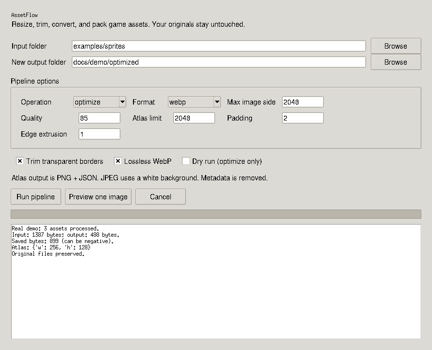
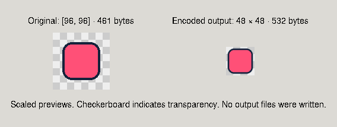

# Authentic AssetFlow demonstration

The screenshots in `demo/` were captured from the running Tk application on Linux with
a virtual display on 26 October 2026. They are not renders or Windows screenshots.
Included outputs were generated by the actual application code. No user activity is
simulated or counted as adoption.

Inspect `demo/optimized/manifest.json`, the encoded images, and `demo/atlas/atlas.json`.
To reproduce: select `examples/sprites`, optimize to a new folder with lossless WebP and
Trim enabled; separately build a 256-pixel atlas. Compression savings can be negative.

## Performance reproduction

Install `psutil`, then run `python scripts/benchmark.py`. The script uses generated,
non-private fixtures and emits JSON with elapsed time, peak RSS, platform and versions.
`demo/benchmark.json` is one actual local measurement, not a speed guarantee. Read the
memory scope: when PID namespaces prevent process-tree sampling, only Python peak RSS
is measured, excluding Chromium children. Do not compare that value with a full browser
process-tree measurement. Native Windows performance has not been measured here.
